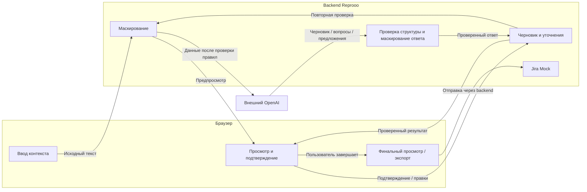
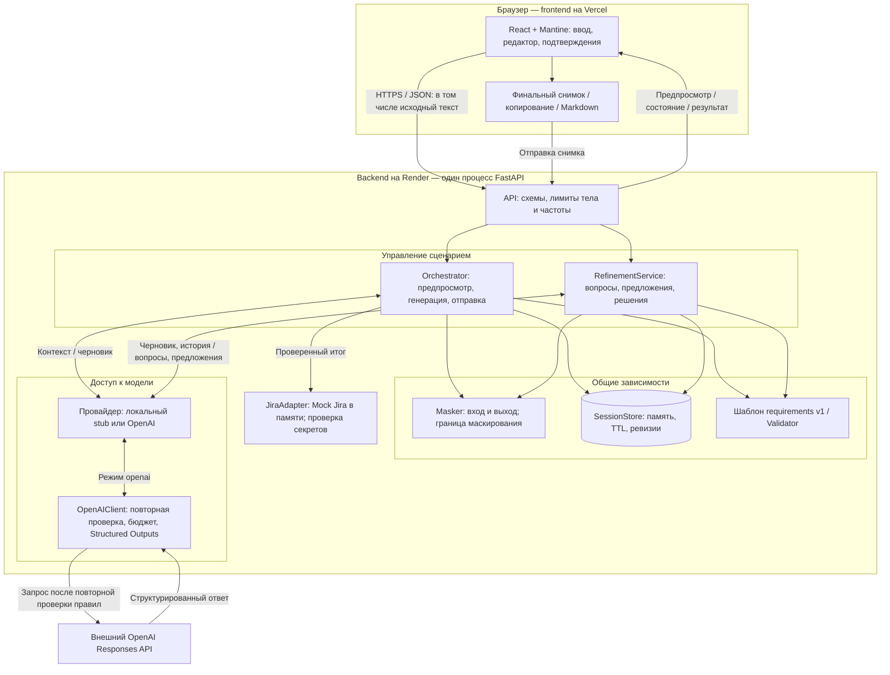

# Reprooo — технический обзор

Дата аудита: 13 ноября 2026 года. Источник технических фактов — текущий код репозитория. Размещение на Vercel и Render, использование OpenAI в публичном приложении указаны владельцем проекта; настройки и состояние работающих сервисов в рамках аудита не проверялись. Публичное приложение: [reprooo-app.vercel.app](https://reprooo-app.vercel.app/).

## 1. Назначение продукта

Reprooo помогает менеджерам, аналитикам, QA и разработчикам превратить неполный бизнес-запрос в структурированные, проверяемые требования. Вход — текст задачи, обсуждения или другого контекста; выход — отредактированный черновик с бизнес-контекстом, требованиями, критериями приёмки и открытыми вопросами. Его можно скопировать, скачать в Markdown или отправить в имитацию Jira.

Отличие от разового запроса к LLM — управляемый процесс: просмотр маскирования, фиксированная структура, отдельный поиск пробелов, ответы пользователя, предложения изменений и явное принятие каждого предложения. Решение о готовности принимает человек. Slack — возможный источник скопированного текста, отдельного подключения к Slack нет.

## 2. Архитектура системы

### Общая схема

Схема показывает основной путь задачи: от исходного текста до подтверждённого результата. OpenAI готовит черновик, вопросы и предложения; изменения принимает пользователь, а backend маскирует исходящие данные и проверяет структуру и маскирует ответ модели перед показом пользователю. Блоки объединяют логические этапы, а не отдельные сервисы; анализ и уточнение запускаются по явному действию.

### Детальная схема компонентов

Схема раскрывает модульный backend: `Orchestrator` ведёт генерацию и отправку, а `RefinementService` — вопросы и решения; оба используют общее состояние и проверки. Стрелки обозначают обращения и передачу результатов, а не автоматическую последовательность вызовов: маскирование и валидация выполняются в вызывающих модулях, дополнительная проверка — в `OpenAIClient`. Браузер, один процесс backend и внешний OpenAI показаны раздельно; Mock Jira остаётся внутри backend.

## 3. Основные модули

Пути ниже указаны от корня репозитория. Строки таблицы объединяют реальные файлы по ответственности; это логические подсистемы, не отдельные сервисы.

| Файлы | Ответственность, вход и выход |
| --- | --- |
| `frontend/src/main.jsx`, `theme.js`, `App.jsx` | Подключают React и тёмную тему Mantine. `App` хранит контекст, выбранные правила, сессию, предпросмотр, результат генерации и шаблон через `useState`; управляет тремя шагами интерфейса. |
| `frontend/src/MaskRuleToggles.jsx` | Строит настраиваемые chips по правилам backend; обязательные категории заблокированы от отключения. |
| `frontend/src/DraftEditor.jsx` | Редактирование разделов, вопросы, ответы, предложения, восстановление состояния, финальный просмотр и отправка. Локальные изменения синхронизируются с сервером по явному действию. |
| `frontend/src/api.js`, `apiConfig.js` | Обёртки над `fetch`, контракт ошибок и проверка адреса API. Внешнего хранилища состояния и отдельной клиентской библиотеки API нет. |
| `frontend/src/refinementState.js`, `finalization.js` | Слияние серверного результата с более поздними локальными правками; сборка списка открытых вопросов, неизменяемый снимок, буфер обмена и Markdown. |
| `backend/app/main.py` | Создаёт FastAPI, зависимости, middleware, обработчики ошибок и маршруты. Допускает операции сессии до передачи в рабочий поток; запускает очистку просроченных сессий. |
| `backend/app/schemas.py`, `refinement_schemas.py` | Pydantic-контракты запросов, ответов, вопросов и предложений; ограничения размеров, типов и допустимых полей. Вторая схема содержит обход свободного текста для общей проверки маскирования. |
| `backend/app/orchestrator.py` | Координирует Masker, SessionStore, провайдер, Validator и JiraAdapter: предпросмотр → генерация → проверка; при отправке проверяет и потребляет сессию. |
| `backend/app/refinement.py` | `RefinementService` синхронизирует черновик, анализирует пробелы через провайдер, проверяет предложения, применяет решения; ведёт историю вопросов, защиту разделов, ревизии и повторы запросов. |
| `backend/app/masking.py`, `masking_config.py` | Нормализация текста, регулярные выражения, UUID-плейсхолдеры, повторная проверка. Вход — текстовые поля; выход — проверенные строки и метаданные категорий без исходных значений. |
| `backend/app/llm_client.py`, `openai_client.py` | Фабрика `create_llm_client`, локальный `LLMClient` и `OpenAIRequirementsGenerator` с общими методами. `OpenAIClient` выполняет Responses API-запрос и проверяет Structured Outputs. |
| `backend/app/template_config.py`, `validation.py` | Реестр одного шаблона; нормализация строковых полей и поиск пустых обязательных разделов. Семантический анализ выполняет провайдер, не Validator. |
| `backend/app/session_store.py` | Сессии в памяти, копии рабочего состояния, атомарная фиксация, блокировки, допуск операций, TTL. Отдельный счётчик оплачиваемых попыток не откатывается вместе с черновиком. |
| `backend/app/jira_adapter.py` | Из пяти полей собирает Summary и Description, повторно проверяет секреты, сохраняет `CreatedTicket` в памяти и возвращает `MOCK-N`. |
| `backend/app/config.py`, `limits.py`, `body_limit.py`, `abuse_protection.py`, `safe_logging.py` | Конфигурация, ограничения памяти и тела запроса, частоты и параллелизма, резервирование бюджета и безопасные диагностические сообщения. |

## 4. Основной сценарий обработки задачи

### Контракты API

Все пути объявлены в `backend/app/main.py`.

| Метод и путь | Назначение | Вызов OpenAI при `LLM_PROVIDER=openai` |
| --- | --- | --- |
| `GET /api/health` | Возвращает `status: ok` | Нет; доступность провайдера не проверяет |
| `GET /api/mask-rules` | Правила и признаки обязательности | Нет |
| `GET /api/templates/{mode}` | Метаданные шаблона; поддержан `requirements` | Нет |
| `POST /api/mask-preview` | Создаёт сессию и маскированный предпросмотр | Нет |
| `POST /api/generate-draft` | Генерирует первый черновик | Да, после проверок |
| `POST /api/clarifications/analyze` | Синхронизирует правки, возвращает вопросы | Да, после проверок |
| `POST /api/clarifications/refine` | Сохраняет ответы и получает предложения | Да, после проверок |
| `POST /api/clarifications/decisions` | Принимает/отклоняет предложения, снимает защиту; синхронизирует финальную версию | Нет |
| `GET /api/sessions/{session_id}/refinement` | Возвращает текущее состояние уточнений | Нет |
| `POST /api/create-ticket` | Создаёт Mock Jira и потребляет сессию | Нет |
| `DELETE /api/sessions/{session_id}` | Удаляет сессию | Нет; текущий UI сбрасывается локально |

### Последовательность и преобразования

1. **Ввод и маскирование.** UI загружает правила. Пользователь отправляет текст и выбранные категории в `mask-preview`. Backend нормализует пробелы и переносы, удаляет некоторые невидимые символы, заменяет совпадения плейсхолдерами и создаёт сессию. В ответе — `session_id` и `masked_text`; исходные значения в сессию не сохраняются.

2. **Подтверждение предпросмотра.** Пользователь может редактировать `masked_text`. При `generate-draft` backend проверяет его снова. Если текст изменился после проверки, возвращает успешный ответ со статусом `preview_review_required`, не вызывает модель и ждёт повторного действия. Для этого первоначального предпросмотра метаданные и TTL фиксируются.

3. **Генерация.** Провайдер получает только проверенный контекст и серверный шаблон. В OpenAI-режиме возвращаются пять строк; отсутствующие факты должны оставаться пустыми, `open_questions` первоначально пуст. Backend нормализует ответ, маскирует его, вычисляет `missing_fields` и создаёт канонический черновик с ревизией. UI отдельно загружает метаданные шаблона; при ошибке загрузки сохраняет результат и позволяет повторить только загрузку.

   Единственный шаблон — `requirements`, версия `1`: `summary`, `business_context`, `requirements`, `acceptance_criteria`, `open_questions`. Обязательны непустые `summary`, `business_context`, `acceptance_criteria`. Это проверка структуры, а не доказательство полноты или качества требований.

4. **Анализ пробелов.** Он запускается отдельной кнопкой через `analyze`, а не автоматически при генерации. Модель получает текущий черновик и историю вопросов, не весь первоначальный контекст. Результат — от нуля до пяти вопросов с разделами, обоснованием, приоритетом `blocking`, `recommended` или `optional` и необязательной точной цитатой. Неточную цитату backend очищает. Вопросы сохраняются в истории; завершённые нормализованные дубликаты возвращаются только при изменении связанных разделов и новом цитируемом свидетельстве. Переформулированные смысловые дубликаты могут остаться.

5. **Уточнение и решения.** Пользователь задаёт статус `unanswered`, `answered`, `skipped`, `not_applicable`, `left_to_implementation` или `needs_stakeholder_decision`. Только `answered` несёт непустой ответ. `refine` передаёт текущий черновик и историю вопросов/ответов провайдеру. Он предлагает замену отдельных разделов с причиной, ссылками на ответы и признаком конфликта. Backend исключает предложения с недопустимыми ссылками, дубликатами разделов или изменением защищённых разделов.

   Предложения не применяются автоматически. `decisions` принимает или отклоняет каждое отдельно; отклонение защищает раздел до явного разрешения новых предложений. Перед применением проверяется совпадение с `base_text`. Это защита от устаревших замен, а не полный смысловой анализ конфликтов. Признак `conflict` приходит от модели и показывается пользователю; отдельного согласования каждой строки требований нет.

   Ручные правки остаются локальными до операции. Если пользователь редактировал раздел во время запроса, `mergeCheckpoint` сохраняет более позднюю локальную версию. При конфликте ревизий UI предлагает явно загрузить и принять серверное состояние.

6. **Финальный просмотр.** UI требует заполнить обязательные поля и отправить либо отбросить локальные ответы. Нерешённые вопросы и непринятые предложения не блокируют завершение. Для добавления нерешённых/делегированных вопросов в `open_questions` требуется выбор пользователя; можно отказаться, сохранив их видимыми в финальном просмотре.

   Подготовка вызывает `decisions` с пустым списком решений: backend проверяет и синхронизирует текст без LLM. После ответа UI делает глубокую копию и замораживает снимок с ревизией, вопросами и предложениями. Следующие правки снимают готовность. Отдельной серверной сущности «утверждённый снимок» или маршрута финализации нет: этот барьер реализован интерфейсом, API по-прежнему принимает черновик.

7. **Экспорт и Mock Jira.** Clipboard API копирует Summary или Description; Blob позволяет скачать `requirements.md`, содержащий пять разделов. Это локальные действия без OpenAI. В экспорт попадает текст снимка, поэтому вопросы, которые пользователь отказался включить, туда автоматически не добавляются.

   При отправке UI передаёт снимок, шаблон, `expected_revision` и `request_id`. Backend ещё раз проверяет данные; JiraAdapter формирует текст и локальную запись. Возвращаемая ссылка на `jira.example.com` демонстрационная. Успех удаляет сессию, повторная отправка не создаёт второй тикет. UI показывает результат до нажатия сброса; сброс очищает ввод, черновик и выбранные категории до значений по умолчанию. Без отправки сброс не удаляет серверную сессию: её удалит TTL.

## 5. Технический стек и инфраструктура

Frontend — JavaScript, React, Mantine, Vite; версии задаются в `frontend/package.json`, зависимости используют диапазоны. Нет Redux, базы в браузере или автоматического восстановления сессии после перезагрузки страницы. Основное состояние живёт в React и `useRef`.

Backend — Python, FastAPI, Pydantic, AnyIO и Uvicorn. Зависимости закреплены в `backend/requirements.txt`; конкретная версия Python здесь не закреплена. Синхронные операции сессии и SDK выполняются через рабочие потоки AnyIO, чтобы ожидание блокировки или OpenAI не блокировало цикл событий.

Для OpenAI используется Python SDK и `responses.parse` со строгими Pydantic Structured Outputs. Разрешён только профиль `gpt-5.4-mini-2026-03-17`; `store=False`, `reasoning.effort=none`, `service_tier=default`, тайм-аут SDK 60 секунд, автоматических повторов нет. Эти параметры описывают код клиента, не проверенную политику хранения данных провайдера. Автоматического переключения на stub при ошибке нет.

| Настройка | Реальное поведение |
| --- | --- |
| `LLM_PROVIDER` | `stub` по умолчанию; `openai` включает реальную генерацию, анализ и предложения. Stub только копирует текст/ответы и спрашивает о пустых обязательных полях; смыслового анализа нет. |
| `OPENAI_API_KEY` | Непустое значение обязательно в OpenAI-режиме. Только окружение backend; `python-dotenv` поддерживает локальную загрузку. Проверка при старте не подтверждает доступ к API. |
| `OPENAI_MODEL` | По умолчанию и единственный разрешённый профиль — указанный выше. Произвольный выбор модели не реализован. |
| `VITE_API_BASE_URL` | Адрес backend во frontend-сборке. В production обязателен явный HTTPS URL; локально без значения используется `http://localhost:8000`. Это публичная настройка, не место для ключа. |
| `APP_ENV`, `CORS_ALLOWED_ORIGINS` | `development` по умолчанию допускает `http://localhost:5173`; `production` требует явные корректные HTTPS origins, без wildcard. CORS не заменяет авторизацию. |
| `TRUSTED_PROXY_CIDRS`, `FORWARDED_ALLOW_IPS` | Первая настройка задаёт доверенные прокси для определения IP; по умолчанию список пуст. Wildcard в обеих настройках запрещён. |
| `MAX_ACTIVE_SESSIONS`, `MAX_MOCK_TICKETS`, `MAX_REFINEMENT_HISTORY_QUESTIONS` | По умолчанию 100, 100 и 40; разрешено только уменьшение до положительного целого. |

Заявленная схема размещения: статическая frontend-сборка на Vercel, API на Render, OpenAI как внешний сервис. Развёртывание предполагает один экземпляр и один процесс Uvicorn. В `docs/ABUSE_PROTECTION.md` приведён запуск с `--workers 1 --no-proxy-headers --no-access-log --log-level warning`, порт берётся из `PORT`. Репозиторий не содержит отдельного манифеста Render/Vercel, подтверждающего действующие настройки.

Постоянной БД нет: черновики, вопросы, метаданные маскирования, Mock Jira и счётчики находятся в памяти. Перезапуск теряет их; общая память между процессами отсутствует. Проверка `/api/health` показывает работоспособность обработчика, не готовность всей цепочки или наличие бюджета.

## 6. Безопасность и контроль ресурсов

### Что защищает маскирование

**Граница защиты:** исходный текст передаётся из браузера на backend Reprooo до маскирования. Маскирование выполняется на backend перед внешним LLM-запросом; OpenAI получает данные, очищенные по реализованным правилам детекции. Это не гарантия отсутствия конфиденциальной информации в запросе.

Правила `secrets` и `tokens` обязательны: распознают поддержанные присваивания паролей/секретов, Bearer/Basic, JWT и некоторые семейства ключей. Остальные категории — имена из Slack, ссылки, email, хеши, кошельки, ID обменов, IPv4, телефоны — включены по умолчанию, но отключаемы пользователем.

Для всех категорий сохраняются только плейсхолдер и категория. `RESTORATION_ALLOWLIST` пуст; `restore` отвергает непустой список разрешений. Выборочного восстановления сейчас нет даже для несекретных значений. Узнанный в одной проверке секрет удаляется из всех текстовых полей этой операции; исходные значения между запросами не запоминаются.

Проверка выполняется перед генерацией, анализом и уточнением, повторяется на границе OpenAIClient и после ответа. Обрабатывается свободный текст черновика, ответов, истории и предложений; служебные ID и перечисления проверяются схемами. При изменении данных уточнения возвращается `preview_review_required` с подписанным `review_token`, привязанным к сессии и ревизии. Он переносит проверенную историю/предложения для повторного запроса; это подпись целостности, не шифрование. Такой ответ не фиксирует правки и не продлевает TTL.

Приложение не является полноценной DLP-системой. Маскирование основано на регулярных выражениях и не гарантирует распознавание всех конфиденциальных данных или защиту от всех утечек. Неизвестный формат секрета, произвольная конфиденциальная фраза, отключённая категория или значение без распознаваемого контекста могут пройти проверку. Тип `SanitizedText` фиксирует прохождение кода проверки, но не доказывает отсутствие чувствительной информации. Пользователь должен проверять маскированные предпросмотры перед продолжением. Для публичных демонстраций следует использовать только синтетические данные.

### Сессии, параллельность и повторы

Идентификатор сессии — 22 символа из `secrets.token_urlsafe(16)`, формат проверяется. Аутентификации нет: знание ID фактически даёт доступ к сессии. TTL — скользящие 900 секунд после успешных изменяющих операций; чтение состояния его не продлевает, ошибка не фиксирует рабочую копию. Первоначальный повторный предпросмотр генерации — описанное выше исключение с продлением. Фоновая очистка выполняется каждые 30 секунд, а доступ проверяет срок отдельно.

Допуск фиксируется до планирования потока. Операции одной сессии сериализуются блокировкой; успешно завершившаяся операция фиксирует копию состояния целиком. Допущенный до истечения срока запрос может закончиться позднее. Отмена HTTP-запроса не гарантирует остановку рабочего потока или внешней обработки; разрешения удерживаются до завершения работы.

Уточнения используют `expected_revision` и `request_id`. Для последних 32 успешных ID хранится HMAC-отпечаток запроса: идентичный повтор возвращает текущий checkpoint без нового вызова модели, изменённый запрос с прежним ID или устаревшая ревизия дают `409 REVISION_CONFLICT`. Это ограниченная защита повторов для уточнений, не универсальная идемпотентность API. Генерация не использует этот журнал; после продвижения ревизии выше 1 повторная генерация запрещена. Отправка тикета потребляет сессию атомарно; её `request_id` не служит кэшем ответа. Если ответ об успехе потерян, повтор получает `SESSION_UNAVAILABLE`, восстановление результата отдельным API не предусмотрено. Оба поля синхронизации отправки можно опустить для старых клиентов — сервер не требует доказательства финального просмотра в UI.

### Проверенные ограничения по умолчанию

Символьные лимиты считаются на backend как Unicode-символы Python; байтовые — отдельно. Меньшие ограничения могут сработать раньше; текст не обрезается молча.

| Ресурс | Ограничение |
| --- | --- |
| Тело HTTP-запроса до разбора JSON | 262 144 байта, 256 КиБ |
| Исходный контекст / предпросмотр | 20 000 / 40 000 символов |
| Черновик | 5 полей, до 20 000 символов каждое, до 50 000 суммарно |
| Ответы в одном запросе | До 20; до 4 000 символов каждый, до 20 000 суммарно |
| Вопросы / предложения за вызов | До 5 / до 5 |
| История вопросов | До 40 записей и 40 000 символов текста, обоснований, цитат и ответов; завершённые тоже учитываются |
| Подписанный `review_token` | До 196 608 символов; сохранённое состояние должно помещаться в него и в допустимый повторный запрос |
| Сессии / Mock Jira в памяти | До 100 / до 100; тикеты автоматически не очищаются |
| Метаданные плейсхолдеров | До 2 000 на сессию |
| Создание предпросмотра | 5 попыток за скользящие 60 секунд на IP |
| Генерация + анализ + уточнение | Общая корзина: 6 попыток за 60 секунд на IP |
| Оплачиваемые обращения | 30 за 60 секунд глобально; 12 за сессию, включая неудачные |
| Параллельные OpenAI-вызовы | 2; превышение отклоняется без ожидания свободного места |
| Допущенные операции сессий | 16, включая ожидающие потока/блокировки |
| IP-идентичности в ограничителе | До 2 048; активные записи не вытесняются |
| Исходящий сериализованный запрос OpenAI | 131 072 байта, 128 КиБ, включая инструкции и нормализованную схему |
| Выход OpenAI: генерация / анализ / уточнение | 4 096 / 2 048 / 4 096 токенов |

Маршрутные ограничения учитывают и невалидные попытки, и запросы, остановленные для просмотра маскирования. Только фактическая отправка OpenAI тратит оплачиваемую квоту; stub её не тратит. Решения, финальная подготовка, экспорт и Mock Jira не требуют оплачиваемого вызова, хотя серверные операции всё ещё ограничены общим допуском и памятью.

IP определяется по socket peer. `X-Forwarded-For` используется только при доверенном непосредственном прокси, с обходом цепочки справа налево. Для этого Uvicorn не должен заранее переписывать peer. Без проверенного контракта ingress Render пользователи за одним прокси могут делить корзину. Эти меры не обеспечивают защиту от распределённой атаки или исчерпания общего бюджета анонимными пользователями.

### Стоимость, ключи и диагностика

В `abuse_protection.py` задан консервативный бюджет резервирования $4 за жизнь процесса. До отправки учитываются 150 000 входных токенов по зашитому профилю $0,75 за миллион и весь разрешённый выход по $4,50 за миллион: $0,130932 для генерации/уточнения, $0,121716 для анализа. Это значения расчётного профиля в коде, а не подтверждение действующих тарифов OpenAI. Учёт ведётся атомарно в целых микродолларах и не возвращает резерв после ошибки, тайм-аута или отказа модели.

Расчёт не опирается на фактический `usage`; это осторожная оценка с предположениями о токенизации и сериализации. Перезапуск обнуляет бюджет, несколько процессов получают независимые бюджеты, другие потребители ключа в него не входят. Поэтому $4 — локальный барьер приложения, не гарантия общего счёта и не лимит биллинга OpenAI Project. Настройки проекта и мониторинг расходов проверяются отдельно; уведомления о бюджете нельзя выдавать за гарантированную остановку расходов.

Ключ OpenAI читается только backend. В исходниках клиента и публичных Vite-переменных он не нужен. Дополнительного хранилища секретов или ротации в приложении нет. Стандартные access- и SDK/HTTP-логи отключены; сообщения ошибок не содержат тела запроса, ответов модели или трассировок. Логи приложения оставляют фиксированные категории и счётчики, что ограничивает диагностику. Настройки логов платформы и её хранение данных этим кодом не управляются.

Ошибки структуры дают безопасный `422`, превышение тела — `413`, частоты — `429`, занятость/ёмкость/бюджет — обычно `503`, конфликт и часть квот — `409`. Ошибка LLM возвращает `502 LLM_GENERATION_FAILED`, тайм-аут — `504 LLM_TIMEOUT`. При временных ограничениях передаётся `Retry-After`, доступный через CORS; UI объясняет ошибку, автоматической повторной отправки нет. Недопустимый или незавершённый структурированный ответ не фиксируется как черновик, но оплачиваемая попытка уже учтена.

## 7. Архитектурные решения и компромиссы

Следующие факты подтверждены кодом; объяснение их пригодности — архитектурная интерпретация для защиты проекта.

- **Модульный backend в одном приложении.** Отдельны маскирование, состояние, шаблон, провайдер, уточнения и адаптер. Для MVP это позволяет проверять границы без затрат на сеть между сервисами и инфраструктуру микросервисов.
- **Общий интерфейс провайдера.** Три метода доступны в stub и OpenAI-реализации. Stub позволяет демонстрировать механику и тестировать без оплаты, но не подменяет реальный смысловой анализ.
- **Предложения вместо полной перегенерации.** Сохраняются канонический текст, исходная версия раздела и решения пользователя. Это уменьшает риск потери согласованных правок, хотя полноту сохранения смысла всё равно проверяет человек.
- **In-memory без БД.** Упрощает запуск, очистку временных данных и атомарные операции одного процесса. Цена — потеря при рестарте, отсутствие долговременного аудита и невозможность простого горизонтального масштабирования.
- **Один процесс и ограниченный параллелизм.** Блокировки и бюджет имеют единый источник состояния. Несколько workers нарушат эту модель; рабочие потоки внутри одного процесса допустимы.
- **Mock Jira.** Демонстрирует сборку конечного артефакта без внешних прав и записей в рабочем трекере. Это не проверка Jira API, его схем, ошибок или авторизации.
- **Решение человека.** Финальный просмотр и экспорт требуют подготовленного снимка в UI. Структурные обязательные поля блокируют отправку, нерешённые вопросы — нет; отдельного достоверного семантического показателя Ready for Development сейчас нет.

## 8. Ограничения MVP и развитие

### Текущие ограничения

| Ограничение | Практическое последствие |
| --- | --- |
| Сессии в памяти | Истекают по TTL и теряются при рестарте. |
| Один процесс backend | Добавление workers не объединяет состояние и квоты. |
| Нет аутентификации | Знание ID даёт доступ к сессии; пользовательских прав нет. |
| Jira Mock | Тикет существует только локально; реальная Jira не вызывается. |
| Нет постоянной истории | Нет долговременного аудита и восстановления работы. |
| Ограниченные OpenAI-вызовы и уточнения | Квоты, бюджет, история и память могут остановить дальнейшие итерации. |
| Маскирование регулярными выражениями | Неизвестные форматы и конфиденциальный смысл могут остаться в тексте. |
| Финализация в браузере | API не требует доказательства прохождения финального экрана. |

Нет аккаунтов, разграничения доступа, постоянного хранения, общей очереди, распределённых квот и восстановления после рестарта. История временная; ID сессии нужно защищать как доступ к данным. Нет загрузки файлов, RAG, базы знаний, живых Slack/Jira и интеграции с репозиториями. Маскирование неполное по природе правил; модель может ошибиться или предложить неподтверждённое. Повторы вопросов отсеиваются преимущественно по нормализованному тексту, не по смыслу.

Финальный снимок существует только в браузере; direct API-клиент не обязан пройти этот экран. Сбой ответа после Mock Jira не позволяет получить созданный тикет повторно. Итерации ограничены оплачиваемой квотой, историей и памятью; обещание неограниченного уточнения не соответствует публичному демо. Проверка здоровья не подтверждает доступность OpenAI. Действующие runtime-настройки хостинга, число процессов, proxy CIDR и платформенные логи по репозиторию не доказаны.

### Рекомендуемые следующие шаги

1. Зафиксировать и проверить конфигурацию деплоя, ingress и диагностические проверки; отдельно контролировать расходы и перезапуски.
2. Перед работой с реальными данными определить политику конфиденциальности, категории детекции и допустимый состав внешних запросов; улучшать маскирование по синтетическим регрессиям. Восстановление потребует отдельной политики и согласования, сейчас оно отсутствует.
3. Добавить аутентификацию, права и устойчивое хранение сессий/истории с правилами удаления. Вынести общие квоты и бюджет из процесса перед масштабированием.
4. Усилить серверную финализацию и идемпотентность отправки с восстановлением результата; оценивать качество вопросов и предложений на сценариях с конфликтами.
5. Реальную Jira подключать отдельным согласованным этапом: права, преобразование полей, безопасные повторы и обработка ошибок. Файлы и база знаний — самостоятельные расширения, не условия текущей демонстрации.

## Основания проверки и расхождения документации

Изучены исходники frontend/backend, зависимости, `README.md`, `docs/PROJECT_CONTEXT.md`, `docs/ABUSE_PROTECTION.md`, `docs/REQUEST_MEMORY_LIMITS.md` и тестовые сценарии. В `backend/tests/` есть проверки маскирования, OpenAI с подменённым SDK, схем, уточнений, сессий, конкурентного допуска, лимитов и CORS; `frontend/src/api.test.js` и `apiConfig.test.js` проверяют клиентские контракты и вспомогательную логику. Наличие тестов не означает, что они запускались в этом аудите; приложение не изменялось, тесты не запускались.

Документация содержит разные временные срезы. `REQUEST_MEMORY_LIMITS.md` описывает Task 7.3.1 без rate limiting; текущий код уже содержит защиты Task 7.3.2. `PROJECT_CONTEXT.md` корректно называет ранние аудиты историческими, но его заключение о будущем анализе/статусах вопросов отстаёт от реализованного `RefinementService`. В README целевой сценарий объединяет генерацию с вопросами и говорит о контроле числа итераций пользователем; фактически вопросы запускаются отдельно, а ресурсы ограничены. Прикрепление документов упомянуто как возможность целевого продукта, но в текущем UI/API отсутствует. Эти материалы не изменялись.
